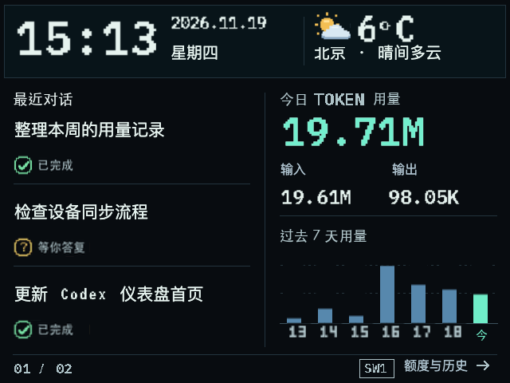
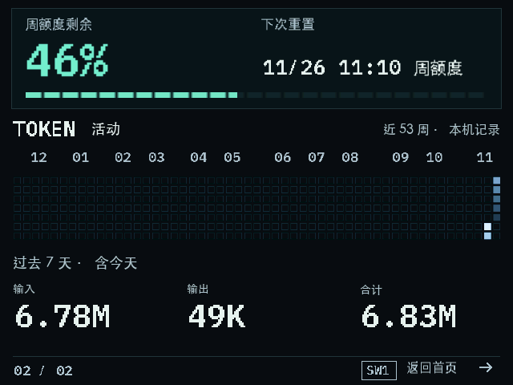

<div align="center">

# HachimoDock · Codex 仪表盘

**Codex 在等你回复吗？今天用了多少 Token？抬眼看一下 Pico。**

[让 Codex 安装](#让-codex-安装) · [看看两个页面](#两个页面) · [下载安装包](https://github.com/guokaixin137-droid/HachimoDock_codex-observatory/releases/tag/v3.1.10)

[](https://github.com/guokaixin137-droid/HachimoDock_codex-observatory/actions/workflows/desktop-install.yml)

</div>

## 让 Codex 安装

在**平时运行 Codex 的那台电脑**上，打开能执行本机命令的 Codex，把下面整段发给它。支持 **Windows x64** 和 **Apple 芯片 Mac**。两个安装包都自带 Python。

```text
请帮我在这台电脑上安装 HachimoDock 的 Codex 仪表盘。
安装指南 https://raw.githubusercontent.com/guokaixin137-droid/HachimoDock_codex-observatory/main/AGENTS.md
请执行指南里对应我这个系统的安装命令，把组件和后台采集器一起装好。
请检查组件已导入、采集器已启动，并告诉我是否读到了本机 Codex 数据。
如果 Pico 已连接，也请帮我在 Hachimodock 里完成同步。
```

电脑端装好后，组件会出现在 Hachimodock 的「我的组件」，采集器会在登录时自动启动。首次传到 Pico 时，用 USB 连接设备，在「组件中心 → 我的组件 → Codex仪表盘」点 **保存并同步**。如果 Pico 已经显示「等待采集器连接」，可以直接用上面这段话补装或检查电脑端。[Codex 安装与验收指南](AGENTS.md)

## 两个页面

| **首页 · 会话与用量** | **按 SW1 · 额度与历史** |
| :---: | :---: |
| [](docs/images/dashboard-home.png) | [](docs/images/dashboard-quota.png) |

短按 **SW1** 可以来回切换。左图是组件首页示例，右图是用 46% 测试额度在 Pico 上截取的画面。

- **对话进度**　最近三条对话各有状态。能一眼看到哪条在思考、哪条等你答复，以及哪条已经完成、停止或出错。
- **Token 用量**　首页显示今天的输入、输出和总量，柱状图方便对照最近七天。第二页还会汇总这七天的用量。
- **额度与活动**　查看 Codex 最近记录的剩余额度、下次重置时间，以及近 53 周的本机活动热力图。
- **时间与天气**　首页顶栏显示日期、时间和城市天气。城市跟随 Hachimodock 的所在地设置，关闭定位可停用天气查询。

## 手动安装与排查

| 你的电脑 | 完整安装包 | 解压后运行 |
| --- | --- | --- |
| Windows x64 | [下载 Windows ZIP](https://github.com/guokaixin137-droid/HachimoDock_codex-observatory/releases/download/v3.1.10/codex-observatory-3.1.10-windows-x64.zip) | `.\install-windows.cmd install` |
| Apple 芯片 Mac | [下载 macOS 压缩包](https://github.com/guokaixin137-droid/HachimoDock_codex-observatory/releases/download/v3.1.10/codex-observatory-3.1.10-macos-arm64.tar.gz) | `./install-macos.command install` |

两个包都包含设备组件和电脑采集器。先在同一台电脑安装 Hachimodock，然后完整解压。安装命令也支持 `check` 检查环境、`status` 查看状态、`remove` 停用采集器并移除登录启动项。[Hachimodock 官方客户端](https://github.com/ai-maker-lab/HachimoDock/releases/tag/v0.1.245)

<details>
<summary><strong>屏幕显示「等待采集器连接」时看哪里？</strong></summary>

运行上表同一入口，把最后的 `install` 换成 `status`。

| 状态输出 | 要检查的事 |
| --- | --- |
| `componentImported` | 为 `true` 时，管理端已选中这份组件。 |
| `registered` 和 `running` | 两项都为 `true` 时，登录启动项和正在运行的采集器均已确认。 |
| `dataReady` | 为 `true` 时，最近一次采集已读到可用记录。首次扫描需要一些时间。尚无记录时，在本机 Codex 完成一次对话后再查。 |
| `deviceSync: not_checked` | 请在管理端查看「保存并同步」的完成回执，并在 Pico 打开仪表盘。 |

自定义 Codex 历史目录、管理端路径、旧版前台采集器及重试步骤见[安装指南](AGENTS.md)。

</details>

<details>
<summary><strong>采集器会读取什么？</strong></summary>

采集器只读本机 Codex 会话索引和日志，整理标题、状态、用量与额度。仪表盘数据由这台电脑上的 Hachimodock 发给 Pico。天气查询会向 Open-Meteo 发送城市级坐标。Windows 使用当前用户的任务计划程序，Mac 使用用户级 LaunchAgent。

</details>
